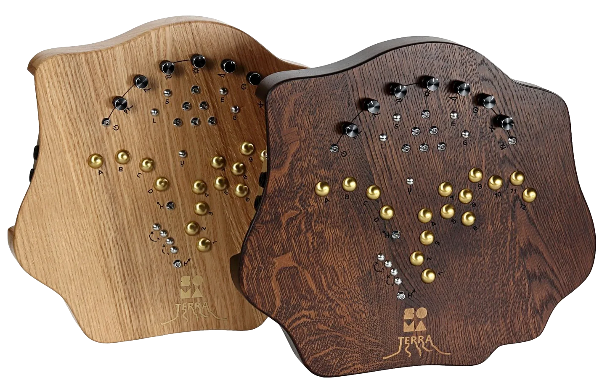

# Terra firmware mods

<p align="center"></p>

Tools, notes and a first mod for the **Soma Laboratory Terra** synthesizer. It lets you build a *modded* firmware
(`.smf`) from your own copy of the official firmware, and install it with the USB stick-based update procedure.

> **Unofficial and unsupported.** Not affiliated with Soma Laboratory. You use this at your own risk and can lose
> presets or end up with an instrument that needs a re-flash. The mods are tested only on firmware **V1.7**.
> This repo contains **no Soma firmware**: you supply the official file; mods are applied as small patches to it.

## What's here

| Path | What |
|---|---|
| `tools/terra_fw/` | Python package + `terra-fw` CLI: container/CRC, preset (`.smp`) codec, patcher |
| `mods/` | Mods (a `mod.toml` per mod): `hold-midi` (Note Hold also holds the MIDI notes), `persist-settings` (pitch-down mode and MIDI mode survive power-off; supersedes `persist-pitchdown`) |
| `symbols/terra_v1.7.toml` | Reverse-engineering notes: addresses, structs, findings for V1.7 |
| `docs/` | `midi-sysex.md` (MIDI/SysEx internals), `bugs/` (analysis of fixed bugs), `flashing-test-plan.md`, `PLAN.md` (roadmap), `ghidra_import.md` |
| `ghidra/scripts/` | Ghidra scripts (SVD register labels, RAM image loader) |
| `tools/scatter_emu.py` | Runs the firmware's startup copy in an emulator to recover the RAM-resident code (ITCM) |
| `reference/` | STM32H743 SVD, RM0433 reference manual (SOMA's PDFs are not included, see [AGENTS.md](AGENTS.md)) |
| `third_party/STM32CubeH7` | **optional** git submodule (ST HAL source, ~1.9 GB, only for decompiling; see [AGENTS.md](AGENTS.md)) |
| `firmware/` | **Your** official `.smf`/`.smp` go here (git-ignored); `KNOWN.md` lists the expected hashes |

## 1. Set up

```bash
git clone <this repo>
cd terra_firmware
```

The only prerequisite is [uv](https://docs.astral.sh/uv/); the first `uv run` creates the environment and installs the dependencies.

Download SOMA's official firmware from <https://somasynths.com/firmware_terra/> and put it in `firmware/`:

```bash
shasum -a 256 firmware/TERRA_V1.7.smf
# 70db296e2db1f553f8378db35eb14aebccc3810a83065b058f47a6f45a8a3572   <- must match; mods refuse any other file
uv run pytest                                            # sanity check (7 tests)
```

## 2. Build and install an existing mod

1. **Back up your Terra.** Insert a USB stick, power on, hold **S**, press **G** (H blinks), then press **H** while holding S+G.
   This writes `TERRA___.smp` with all 96 presets and pitch-shifter settings. Copy it off the stick. (It should be the same format as the factory `TERRA_0.smp`, so `terra-fw info` can read it; untested.)
2. **Build:**
   ```bash
   uv run terra-fw patch firmware/TERRA_V1.7.smf dist mods/hold-midi/mod.toml --auto-name
   # -> dist/TERRA_V1.7_holdmidi/TERRA_V1.7_holdmidi.smf
   ```
   Several mods can be combined: list more `mod.toml` files (overlapping hooks are rejected).
3. **Prepare the stick** as the manual says (p. 23): FAT32, 1-32 GB (USB 2.0 sticks are the safest), and **exactly one firmware file in
   the root**. Copy the *contents* of the output folder onto it.
   File names must look like `TERRA_V<version>_<suffix>.smf`: the updater recognises that pattern (a different prefix is ignored).
4. **Update:** insert the stick, power on, hold **L+E** (the hold LED must blink; if not, the name was not recognised), then press **H** while holding L.
   The triangle LEDs lighting in a circle = success. If the LEDs blink endlessly, power-cycle and retry or try another stick.
5. **Go back to stock any time** by installing the official `TERRA_V1.7.smf` the same way.

## 3. Write your own mod

A mod is a folder in `mods/<id>/` with a `mod.toml`:

```toml
[mod]
id = "my-mod"
version = "0.1.0"
fw_version = "1.7"                       # used in the file name
targets = ["70db296e..."]                # SHA-256 of the stock .smf this mod was written for

[[hook]]
at     = 0x080399DA                      # address (in flash) of the instruction to replace with `b.w <your code>`
expect = "2888dff8"                      # the original bytes there: the build is refused if they differ
asm    = """                             # your replacement code, Thumb-2 (keystone syntax)
ldrh r0, [r5]
ldrh.w ip, [r5, #0x60]
orrs.w r0, r0, ip
movw r2, #0x3394
movt r2, #0x2000
b.w #0x080399E2                          # jump back; targets are absolute addresses
"""
```

How it works: the patcher appends your code after the end of the application image (`0x08059A54`+), overwrites 4 bytes at `at` with a
`b.w` to it, recalculates the CRC, and writes a new `.smf`. Only those 4 bytes of the original are touched; the bootloader (assumed to sit below `0x08020000`) is never modified.

Rules of thumb:
* Replace whole instructions; if your hook displaces instructions, **redo them** in your code (e.g. PC-relative literal loads must become `movw/movt`).
* Respect the calling convention: `r0-r3`, `r12` (`ip`) are scratch only if the surrounding code does not keep a live value there. Check the code around the hook.
* Code that runs from ITCM (addresses below `0x10000`, e.g. the audio interrupt at `0x9730`) is copied to RAM at boot, so it can't be patched in flash this way yet.
* keystone silently mis-assembles a backward `cbz`/`cbnz`: use `cmp` + `beq` instead.
* Run `uv run pytest` and, for new hooks, emulate the trampoline (see how `hold-midi` was checked in `docs/bugs/hold-midi-notes.md`).

### Finding where to hook
1. Read [symbols/terra_v1.7.toml](symbols/terra_v1.7.toml) and [docs/midi-sysex.md](docs/midi-sysex.md): the main loop, MIDI generator, SysEx handler, EEPROM layout and sensor scan are already mapped.
2. Load the firmware in Ghidra: [docs/ghidra_import.md](docs/ghidra_import.md) (raw binary, ARM Cortex, base `0x08020000`; run `ghidra/scripts/LoadSvd.java` and `LoadRamImage.java`).
   `uv run terra-fw unpack firmware/TERRA_V1.7.smf build/app.bin` extracts the image; `uv run python tools/scatter_emu.py build/app.bin build/ram` recovers RAM code.
3. Write a short analysis (`docs/bugs/…` is a good model), then the `mod.toml`, then test as in section 2.

## Tools

```bash
uv run terra-fw info FILE            # verify checksum, describe an .smf/.smp
uv run terra-fw unpack FILE OUT      # .smf -> raw image, .smp -> JSON
uv run terra-fw pack SRC OUT --like ORIGINAL
uv run terra-fw patch STOCK.smf OUT MOD.toml [MOD.toml ...] [--auto-name]
uv run terra-fw padtest STOCK.smf OUT
```

## Known limits
* Only V1.7 is supported. A new SOMA release needs the hooks re-checked against the new image.
* The bootloader's behaviour after a *crashing* application image is unverified; keep a stick with the stock file.
* Held notes (`hold-midi`): polyphonic aftertouch of a released-but-held key goes to 0.

## Licence

Original work in this repository (the `terra-fw` tools, scripts, mods, notes and docs) is licensed under the
**GNU General Public License v2.0 or later** ([LICENSE](LICENSE), SPDX `GPL-2.0-or-later`). Copyright (C) 2026 Toon Stegen.

Not covered by that licence:
* **SOMA Laboratory:** the TERRA firmware, manuals, preset files and name belong to SOMA. This repo contains none of them, and a
  firmware file built with `terra-fw patch` contains SOMA's code, so **do not publish built `.smf` files**; share the mod instead.
  Applying a GPL mod to firmware does not place SOMA's code under the GPL.
* **STMicroelectronics:** `reference/STM32H743.svd`, `reference/RM0433.pdf` and `third_party/STM32CubeH7` keep their own licences.
* Dependencies (keystone, capstone, unicorn, pytest) are installed separately by the user under their own licences; they are not distributed here.
